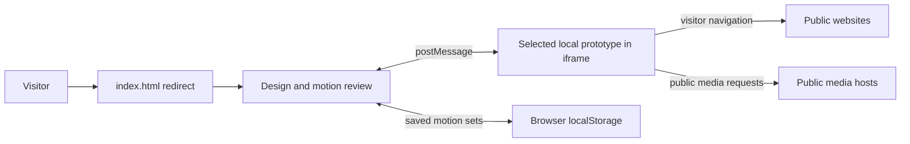

<!-- Auto-generated by the documentation-automation workflow on 2026-10-26. -->

# Architecture

## Overview

Clayco Homepage is a static design-and-motion review package. The root [`index.html`](../index.html) redirects visitors to the review interface. The published URL in the repository README is <https://claycobusinesssolutions.github.io/Clayco-Homepage/> (`README.md:5-7`). The repository does not contain an application server or backend.

The review interface embeds one of five local homepage prototypes in an iframe and lets a reviewer compare designs and motion treatments (`Clayco Landing Page Studies/review/index.html:22-60`). HTML, CSS, JavaScript, fonts, images, and videos are static files in the repository. The repository README says the package is generated from the LJC Website Study project and should be rebuilt there (`README.md:7`).

## Components and data flow

- **Entry page:** `index.html` redirects to the review (`index.html:1-8`).
- **Review controls:** `Clayco Landing Page Studies/review/index.html` selects designs, motion presets, preview size, and page sections (`Clayco Landing Page Studies/review/index.html:22-60`).
- **Review controller and motion adapters:** the review loads the selected prototype and sends motion settings to its iframe; the bridge checks the reply source and origin (`Clayco Landing Page Studies/review/review.js:5-24`, `Clayco Landing Page Studies/review/motion-bridge.js:6-12`).
- **Prototype pages:** five options are listed in the controls (`Clayco Landing Page Studies/review/index.html:22-30`); each is a local static page.
- **Local preferences:** saved motion sets and intro state are kept in browser storage, not a service (`Clayco Landing Page Studies/review/review.js:32-33`, `Clayco Landing Page Studies/review/designs/sam-alcarez-original/assets/home-intro.js:8,21-22`).
- **Public media:** some standalone prototypes and study pages load media from public CDNs; the offline review package also contains local media (`Clayco Landing Page Studies/Clayco Home Motion Options.html:659,697-704`, `README.txt:11-12`).

## Technology and design decisions

- Static HTML, CSS, and browser JavaScript; no package manifest or server-side application is present.
- The review displays the selected prototype in an iframe and uses a message bridge to control motion (`Clayco Landing Page Studies/review/index.html:55-60`, `Clayco Landing Page Studies/review/motion-bridge.js:14-44`).
- Saved motion sets and presentation preferences are browser-local. A copied review URL can carry the selected design and motion settings (`Clayco Landing Page Studies/review/review.js:32-48`, `Clayco Landing Page Studies/Clayco Home Motion Options.html:780-791,1177-1198`).
- The root and review pages set `noindex,nofollow` (`index.html:2-4`, `Clayco Landing Page Studies/review/index.html:3-7`).

## Configuration and limits

No GitHub Actions workflows, application configuration, infrastructure definitions, environment variables, or deployment resources are present in the repository. The issue's resolved-configuration input contains no usable variable/value rows; therefore no deployed resource identity or cloud setting can be stated from it. Do not infer those values from prototype content or the advertised GitHub Pages URL.
