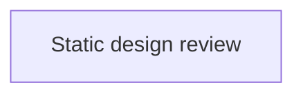

<!-- Auto-generated by the documentation-automation workflow on 2026-10-26. -->

# Integrations

This repository has **no authenticated application-to-service integrations**: it contains no API client, database connection, cloud storage client, messaging client, or identity-provider flow. Some prototype pages do load public media directly in the browser, and prototypes link out to public websites. If those links or media are unavailable, the destination or media fails; the review controls and bundled content remain available.

| Dependency | Type | Direction | Auth method | Credential location | Environments |
|---|---|---|---|---|---|
| `claycorp.com`, `realcrg.com`, `theljc.com`, `concretestrategies.com`, `ventana.vc`, `claycorising.com` | Public web navigation | Browser outbound on visitor action | None | None | Static prototypes |
| `app.buildingconnected.com` | Public vendor portal link | Browser outbound on visitor action | None in this repository | None | Static prototypes |
| `www.bdcnetwork.com`, `www.bizjournals.com`, `www.enr.com`, `www.forbes.com`, `www.pci.org`, `www.decodingstl.org`, `www.stlouis-mo.gov` | Public news and project links | Browser outbound on visitor action | None | None | Static prototypes |
| `www.facebook.com`, `www.instagram.com`, `www.linkedin.com`, `www.twitter.com`, `www.youtube.com`, `www.thiscardigan.com`, `www.newmediacampaigns.com` | Public social and design-credit links | Browser outbound on visitor action | None | None | Static prototypes |
| `e1.nmcdn.io`, `storage.ghost.io` | Images and video media | Browser outbound media requests | None | None | Some prototype/study pages |
| `www.google.com` | Google Maps search link | Browser outbound on visitor action | None | None | Office links |

## Public websites (navigation only)

Prototype pages link to the Clayco public website (`claycorp.com`), CRG (`realcrg.com`), LJC (`theljc.com`), Concrete Strategies (`concretestrategies.com`), Ventana (`ventana.vc`), Clayco Rising (`claycorising.com`), and BuildingConnected (`app.buildingconnected.com`). They also link to news/project sources (`www.bdcnetwork.com`, `www.bizjournals.com`, `www.enr.com`, `www.forbes.com`, `www.pci.org`, `www.decodingstl.org`, `www.stlouis-mo.gov`), social sites (`www.facebook.com`, `www.instagram.com`, `www.linkedin.com`, `www.twitter.com`, `www.youtube.com`), and design-credit sites (`www.newmediacampaigns.com`, `www.thiscardigan.com`). The office links open Google Maps (`www.google.com`). These links are visitor navigation rather than API calls; the static site does not authenticate to these destinations. Examples and implementation are in `animated/clayco-b.html:79-86`, `animated/clayco-nav.json:563-611`, `animated/office-galleries.js:34`, and `Clayco Landing Page Studies/review/designs/sam-alcarez-new/index.html:540-570`.

## Public media

`e1.nmcdn.io` serves image/video assets referenced by prototype and motion-study pages; the motion study defines that media base and directly references three video files (`Clayco Landing Page Studies/Clayco Home Motion Options.html:659,697-704`). `storage.ghost.io` is referenced by the LJC project page (`animated/project-ljc.html:92`). These are public browser media requests without credentials; if a media host is unavailable, its assets do not load. The offline package remaps many remote image URLs to bundled files (`Clayco Landing Page Studies/review/offline-media.js:1-5`).

No SQL, storage service, Service Bus, Snowflake, SaaS API, internal Clayco API, Key Vault, federated identity, private endpoint, or firewall configuration is present in the repository. The source README notes that some public links and videos are online-only (`README.txt:11-12`).
